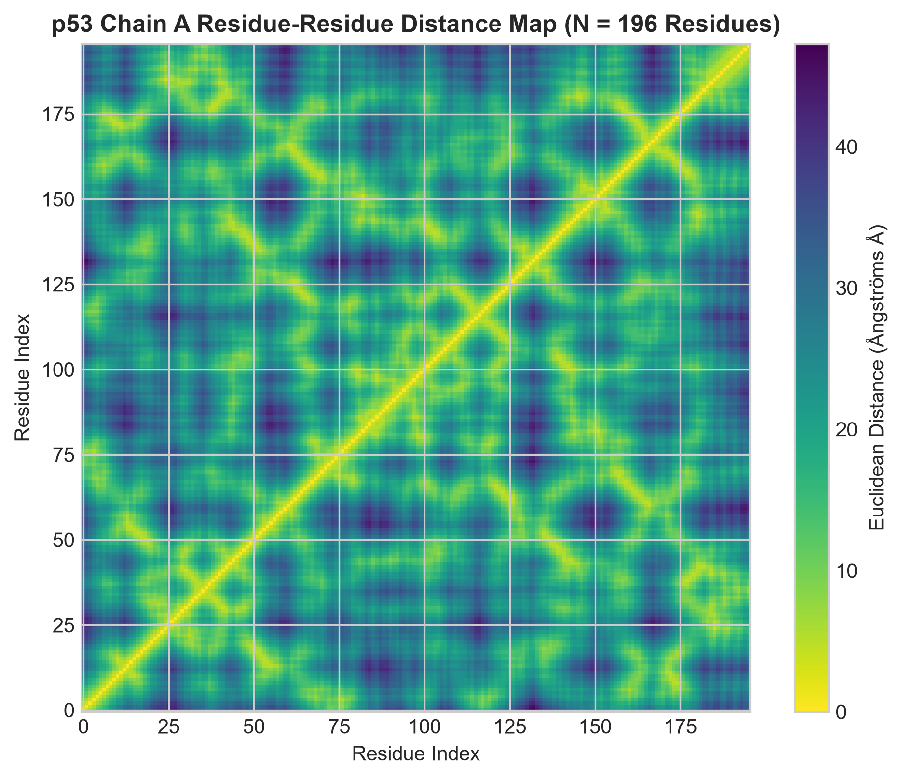
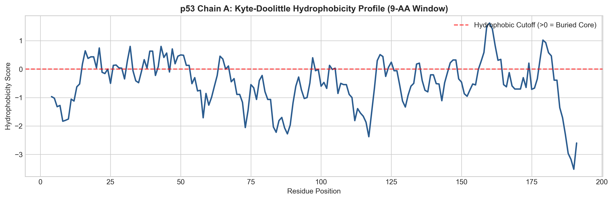
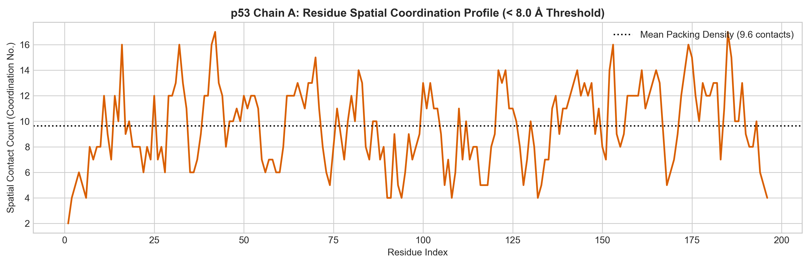
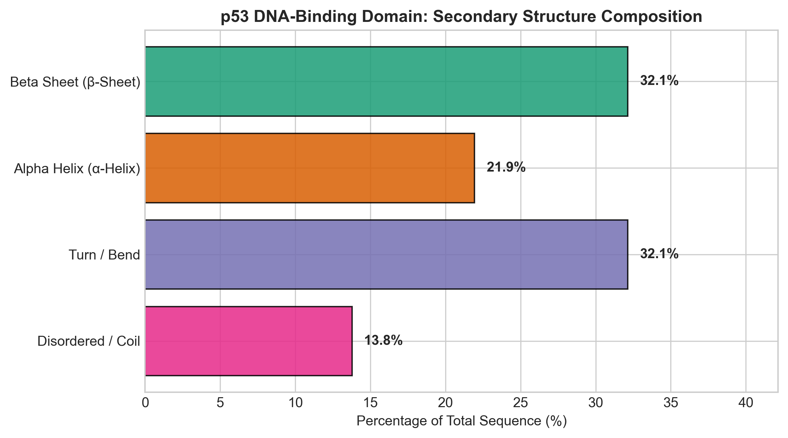

# 🧬 3D Structural Bioinformatics & Sequence-to-Structure Pipeline

[](https://nbviewer.org/github/stephfn/protein-structure-folding-pipeline/blob/main/01_sequence_to_3d_structure.ipynb)
[](https://www.python.org/)
[](https://biopython.org/)
[](https://opensource.org/licenses/MIT)

> **Note:** GitHub's static preview strips WebGL/JavaScript widgets. Click the **Render with nbviewer** badge above to view and interactively rotate the live 3D molecular structures!

---

## 📌 Project Overview
This repository implements an end-to-end structural bioinformatics pipeline that bridges **primary protein sequences**, **2D spatial contact maps**, and **3D macromolecular structures**. 

Using the human tumor suppressor **p53 DNA-binding domain (PDB ID: `1TUP`)** as an oncology target, this pipeline demonstrates programmatic structure retrieval, biophysical sequence feature extraction, spatial coordinate transformation, and structural motif quantification.

---

## 🔬 Core Analysis Modules & Visualizations

### 1. 3D Structure Retrieval & Interactive Visualization
* Automated fetch of atomic coordinates from the RCSB Protein Data Bank via `BioPython`.
* Interactive WebGL rendering using `py3Dmol`, color-coded by secondary structure motifs ($\alpha$-helices, $\beta$-sheets, and flexible loop regions).

---

### 2. Residue-Residue Pairwise Distance Matrix (Contact Map)
* Extracts $\text{C}_\alpha$ Cartesian spatial coordinates ($x, y, z$) to compute the full Euclidean distance matrix ($d = \sqrt{\Delta x^2 + \Delta y^2 + \Delta z^2}$).
* Visualizes long-range tertiary folding contacts ($0\text{--}40+\text{ Å}$) required for active site stabilization and DNA interaction.



---

### 3. Sequence Biophysical Feature Profiling
* Computes global physical properties: **Molecular Weight** ($\text{kDa}$) and **Isoelectric Point** ($\text{pI}$).
* Evaluates local hydrophobicity along the backbone using a 9-residue window on the **Kyte-Doolittle scale** to locate hydrophobic cores vs. solvent-exposed surface regions.



---

### 4. Spatial Coordination & Contact Density Analysis
* Applies an $8.0\text{ Å}$ spatial cutoff threshold to calculate residue **Coordination Numbers** (packing density).
* Distinguishes densely packed core residues from flexible, accessible surface loops.



---

### 5. Secondary Structure Motif Quantification
* Parses structural architecture to quantify the sequence percentage dedicated to $\beta$-sheet sandwiches, $\alpha$-helices, turns, and disordered coils.



---

## 🛠️ Repository Architecture

```text
protein-structure-folding-pipeline/
├── 01_sequence_to_3d_structure.ipynb  # Primary Jupyter Pipeline
├── p53_distance_matrix.png             # 2D Pairwise Euclidean Distance Heatmap
├── p53_hydrophobicity_profile.png      # Kyte-Doolittle Hydrophobicity Profile
├── p53_coordination_profile.png        # Spatial Contact Density (<8.0 Å)
├── p53_secondary_structure_composition.png # Secondary Motif Breakdown Chart
├── pdb1tup.ent                         # Raw RCSB PDB Structure File
└── README.md                           # Project Documentation
```
---

## 🧬 Biological Context & Key Takeaways

* **Target:** Human p53 core domain bound to DNA (PDB ID: `1TUP`).
* **Tertiary Architecture:** Heavily enriched in $\beta$-sheet sandwich architecture (~33%), stabilized by coordination loops and a structural zinc ion.
* **Machine Learning Relevance:** Pairwise distance maps ($\text{C}_\alpha\text{--C}_\alpha$) generated in this pipeline represent the fundamental ground-truth representations used by deep learning structural models (e.g., AlphaFold2 / ESMFold) to predict 3D folding directly from sequence embeddings.
